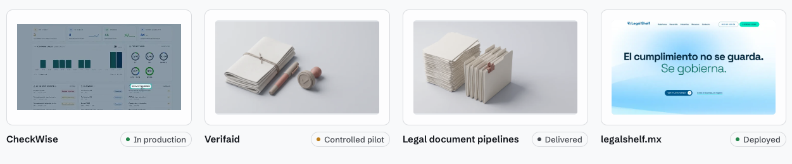
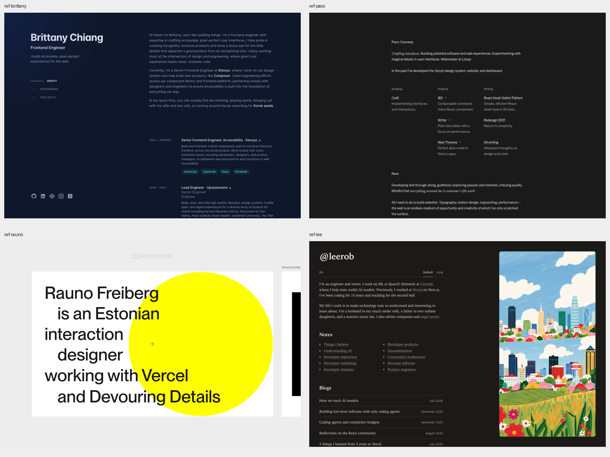

# Production visual review — 2 October 2026

Site reviewed: https://jpsamanosuarez.com. Production deployment: `dpl_APwUdDeGu8zqw2SrGQG25Xe5iMba`; source commit `a29dfaa`.

## Design judgment

The portfolio has a useful foundation: a distinctive name treatment, restrained typography, readable case-study prose, real operating metrics, and bilingual routes. The largest weakness is the choice and hierarchy of project imagery. The generated still lifes describe the category of work, while screenshots demonstrate the work itself. Presenting both as equally prominent project covers makes the site feel assembled from two visual systems.

The framing pass brought borders and saturation closer together. It did not resolve the difference in subject matter, scale, information density, or purpose. Further image filters will have diminishing returns.

Recommendation: retain the name, existing type families, and quiet shell. Make real software views and carefully drawn system explanations the main visual material. Give every featured project one primary artifact that explains what it does.

## Review scope and observations

Inspected the full English homepage at 1440 px and 390 px, the Spanish homepage at 390 px, homepage sections in light/dark appearance, all seven English case studies on desktop/mobile, and the Summer 2026 report. Checked reduced-motion behavior on the CheckWise case study. These were Chromium visual checks; no Safari/iOS device claim is implied.

At the captured viewport sizes the English homepage was 7,760 px tall on desktop and 11,736 px on mobile. The Spanish mobile homepage was 12,075 px tall. These are viewport-specific measurements, not universal performance measures. English mobile is about fourteen 844 px screens long. The four featured projects are a sensible count; repetition across the opening reel, overlapping figures, method section, and nine additional large cards makes the homepage much longer than that count suggests.

### 1. Project covers switch visual languages

- CheckWise: dense, blue/teal working interface with tables, navigation, verdicts, and real controls.
- Verifaid: large, softly lit paper bundle, pen, and stamp. The image does not reveal the citation viewer, signing limits, or human approval step described by the project.
- Document pipelines: softly lit paper and folders. The image does not explain extraction, resumability, output structure, or hash verification.
- legalshelf.mx: a colorful screenshot of a real website.
- “Also shipped” repeats the switch: SAVR and Band of Brothers show interfaces, followed by house/car, magnifying glass, and terminal still lifes.

The warm, tactile generated objects and cool, information-dense software views have different visual weight even inside identical frames. In dark appearance the light rectangular artwork backgrounds remain especially prominent.

### 2. The primary software recording is frequently dimmed

CheckWise's recording has a tutorial-style spotlight: most of the interface is gray while a small control is highlighted. This dimming is present in the recorded content. The live computed CSS filter on the interface image/video is `none`.

Use the clean dashboard screenshot as the resting cover. Re-record an unobscured workflow for the case study: upload → analysis → review decision, with a readable pointer and short caption. The captured primary clip is eight seconds and loops without visible controls. Reduced-motion correctly leaves a still poster; a visible pause/play action would improve the normal-motion experience.

### 3. Overlapping figures reduce readability

The secondary image occupies 66% of its parent on desktop and 80% on mobile, with negative margins. It covers part of the primary artifact. In the sampled mobile case, an entire desktop CheckWise interface was displayed about 329 px wide. Large illustrations survive that reduction; small UI labels do not.

Use one unobstructed primary figure on the homepage. Put a second view below it or inside the case-study gallery. For mobile, pair the overall interface with a focused crop of one decision, citation, or result. Keep full screenshots available through a keyboard-accessible enlarged view.

### 4. The case-study prose is stronger than the decorative images

Problem, constraints, decisions, outcome, and evidence give the work a useful engineering narrative. Keep that structure. The existing labeled SVG flows for Verifaid and pipelines already fit the portfolio typography better than the generated blueprint drawings, but they currently sit below a much larger ornamental cover.

Promote a richer version of those explanations when a real interface cannot be shown. Include actual inputs, an important gate, and a concrete output. Make branches such as text-versus-vision reading visible. A system diagram should explain an implementation decision, rather than merely depict paper moving between folders.

### 5. The Summer report changes the site identity

The report has a vivid cobalt hero, grid background, very large chapter numbers, duplicated navigation, and its own language buttons. The main portfolio uses cool neutrals, a coral accent, and a different header. The report can remain a distinct long-form story while sharing the portfolio's header, typography, colors, image treatment, and language navigation.

### 6. Information hierarchy can support the new research role

The homepage still introduces LegalShelf and CheckWise without the new AARH role. Add Research Assistant at Acadia AIoT Research Hub to a compact current-experience block or the short hero introduction. Put client adoption, processing outcomes, and important engineering decisions ahead of commit totals. Keep dated test counts and commit history in case-study evidence.

The name treatment is worth retaining as the memorable element. On mobile the portrait is very small; move a clearer portrait to About if its current crop no longer serves the layout. The Schibsted Grotesk body text, Archivo name, and JetBrains Mono dates/figures already provide enough typographic variety.

## Concrete asset replacement plan

| Area | Recommended primary visual | Secondary material |
| --- | --- | --- |
| CheckWise | Clean dashboard or readable acceptance decision from the real app with demo data | Short unobscured review workflow; detailed calendar/reviewer views in the case study |
| Verifaid | Real citation viewer and authority decision using synthetic documents | Actual seven-stage pipeline with citation and human approval gates; label a diagram as a diagram if an interface capture is unavailable |
| Legal document pipelines | A clearly labeled extraction flow and sample output table | Copy-only/hash verification result, resume/retry path, or before/after archive structure; label any sample data explicitly |
| legalshelf.mx | Actual page screenshot, cropped to communicate the redesigned site | One useful interaction or comparison in the case study |
| La Red de Casa | Real trip/approval view with demo data | Small workflow diagram if a useful capture is unavailable |
| Cotejo | Actual comparison window: source PDF and matched/unverified fields | One annotated example of a verification decision |
| POS Geocoder | Actual table/map/result export | Input coordinates → verified address/INEGI code diagram |
| AI in legal practice | Actual slide or talk landing page | Event context or a representative lesson |
| SAVR, Band of Brothers, ER Triage, Family Phrase Game | Keep the genuine application views | Choose a crop that communicates one action or outcome |
| How I build | Authored diagram of worktree → checks → approval → deployment, with shared knowledge shown separately | Short process summary; detailed operational claims stay in the report |

No client document capture is required to achieve this direction. Synthetic data in the real interface and clearly labeled architectural explanations are useful evidence. Avoid presenting a fabricated UI mockup as a production screenshot.

## Visual rules for the next implementation

- Keep the current neutral light/dark shell and a restrained coral accent. Product screenshots retain their actual brand colors.
- Keep Archivo for the name and Schibsted Grotesk for prose. Reserve JetBrains Mono for dates and figures.
- Use one 16:10 presentation area for homepage covers, consistent padding, one border, and one caption placement. Preserve native proportions in detailed galleries. Deliberately crop around a task rather than squeezing a whole screen into every card.
- Remove ornamental 3D covers from the main work sections. Do not desaturate real interfaces to imitate them.
- Use one main figure per homepage project. Replace image overlap with a clear reading order.
- Use static covers in the overview. Put useful motion in an explicitly playable project demo. Retain the existing reduced-motion stills.
- Keep mobile project choices visible without relying on the horizontal reel as the only way to discover them. A compact two-column or vertical overview can replace the duplicated reel.
- Reduce “Also shipped” to a compact project list or smaller archive, with a few real thumbnails. Keep detailed exploration in the case studies and Summer report.
- Bring the Summer report into the same site shell.

Suggested homepage order: name and short current-role introduction → selected work → compact LegalShelf/AARH experience → concise method → additional work/archive link → About and contact.

## Reference portfolios and transferable ideas

These are selected references for different strengths, not a defensible ranking of the “best” computer science portfolios.

| Reference | Observed strength | Transfer to this portfolio |
| --- | --- | --- |
| [Brittany Chiang](https://brittanychiang.com/) | Clear role introduction, consistent hierarchy, compact project screenshots, separate experience and project sections | Make the current roles and best work easy to scan; keep a distinct JP identity rather than copying the layout |
| [Paco Coursey](https://paco.me/) and [Craft](https://paco.me/craft) | Restrained page shell; focused interface/interaction examples are organized separately | Let the work carry detail; use an interaction to demonstrate an engineering choice |
| [Rauno Freiberg](https://rauno.me/) and [Projects](https://rauno.me/projects) | Strong typographic identity and a curated collection of software/design work | Concentrate personality in one deliberate gesture, and give the rest a consistent rhythm |
| [Lee Robinson](https://leerob.com/) | Concise identity and compact indexes; a deliberate illustration has its own role beside the content | Artwork can work when it has a clear place in the identity; it should not replace project evidence |
| [Bruno Simon](https://bruno-simon.com/) | The site explicitly presents an interactive 3D world as the creative developer's portfolio | An immersive treatment makes sense when the interaction itself demonstrates the specialty; a complex 3D world is not the direction recommended for this work |

[Josh Comeau's portfolio guidance](https://www.joshwcomeau.com/effective-portfolio/) recommends curating two to five projects and guiding prospective employers through the important work. Your four featured systems already meet that range. The next step is making their artifacts clearer and reducing repetition.

## Implementation order

1. Replace Verifaid and pipeline lead artwork with actual demo captures or precise, labeled system explanations. Make the CheckWise cover an unobscured still.
2. Remove overlapping figures and establish the same cover/caption rules across featured work and the smaller project collection.
3. Shorten the homepage by consolidating the reel, method, and additional-project cards. Make the new research role visible.
4. Restyle the Summer report shell and check all revised assets on desktop/mobile in both themes and languages.

The review leaves the production application unchanged. Local screenshot evidence accompanies this document; additional full-page captures are in `/tmp/jp-visual-audit-20261002`.
